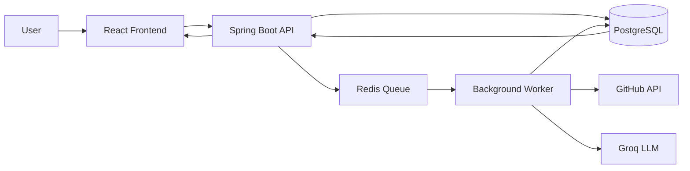

# AI Repository Analyzer

An asynchronous AI-powered GitHub repository analysis platform built with Spring Boot, Redis, PostgreSQL, React, and Groq.

## Overview

This application analyzes public GitHub repositories by fetching metadata, calculating metrics, and generating AI-powered summaries. The system uses an asynchronous architecture where the API returns immediately after job creation, and background workers process the analysis tasks.

## Features

- **Asynchronous Processing**: Non-blocking API with background job processing
- **Repository Analysis**: Fetches and analyzes GitHub repository data
- **AI Summaries**: Generates intelligent repository descriptions using Groq's LLaMA models
- **Metrics Calculation**: Computes stars, forks, language distribution, contributor stats, and more
- **Retry Mechanism**: Automatic retry for failed jobs with exponential backoff
- **Rate Limiting**: Protection against API abuse
- **RESTful API**: Clean API endpoints for job management
- **React Frontend**: Interactive UI for submitting repositories and viewing results

## Architecture



### Request Flow

1. User submits a GitHub repository URL through the frontend
2. Frontend sends request to `/api/analyze` endpoint
3. Backend validates URL, creates job record, and returns job ID immediately
4. Job ID is pushed to Redis queue
5. Background worker pulls job from queue and begins processing
6. Worker fetches repository data from GitHub API
7. Worker calculates repository metrics (stars, forks, language breakdown, etc.)
8. Worker sends relevant data to Groq AI for summary generation
9. Results are stored in PostgreSQL and job marked as completed
10. Frontend polls for job status and displays results when complete

## Technology Stack

### Backend
- **Java 17**
- **Spring Boot 4.0.5** (Web MVC, Data JPA, Data Redis, Validation, Actuator)
- **PostgreSQL** with Spring Data JPA
- **Redis** (via Spring Data Redis) for job queuing
- **Lombok** for reduced boilerplate
- **RESTTemplate** for GitHub API calls
- **WebClient** for Groq AI API calls

### Frontend
- **React 18**
- **Axios** for HTTP requests
- **Recharts** for data visualization
- **React-CountUp** for animated counters
- **React-Calendar-Heatmap** for commit activity visualization
- **CSS3** with modern styling

### Infrastructure
- **PostgreSQL** for persistent job storage
- **Redis** for job queuing (compatible with Upstash)
- **Docker** for containerization
- **GitHub Actions** for CI/CD

## API Endpoints

### Analyze Repository
```http
POST /api/analyze
Content-Type: application/json

{
  "repoUrl": "https://github.com/owner/repo"
}
```

**Response:**
```json
{
  "id": 42,
  "repoUrl": "https://github.com/owner/repo",
  "status": "PENDING",
  "createdAt": "2026-04-16T10:30:00Z"
}
```
*Returns HTTP 202 Accepted for asynchronous processing*

### Get Job Status
```http
GET /api/analyze/{jobId}
```

**Response (Pending):**
```json
{
  "id": 42,
  "repoUrl": "https://github.com/owner/repo",
  "status": "PENDING",
  "createdAt": "2026-04-16T10:30:00Z"
}
```

**Response (Completed):**
```json
{
  "id": 42,
  "repoUrl": "https://github.com/owner/repo",
  "status": "COMPLETED",
  "createdAt": "2026-04-16T10:30:00Z",
  "completedAt": "2026-04-16T10:35:22Z",
  "analysisResult": "{...}", // JSON with full analysis
  "summary": "Repository analysis summary",
  "retryCount": 0,
  "maxRetries": 3
}
```

**Response (Failed):**
```json
{
  "id": 42,
  "repoUrl": "https://github.com/owner/repo",
  "status": "FAILED",
  "createdAt": "2026-04-16T10:30:00Z",
  "completedAt": "2026-04-16T10:35:22Z",
  "analysisResult": null,
  "summary": null,
  "errorMessage": "Failed to fetch repository data",
  "retryCount": 3,
  "maxRetries": 3
}
```

### Health Check
```http
GET /actuator/health
```

## System Design

### Asynchronous Job Processing

The system uses a producer-consumer pattern:
- **Producer**: REST controller creates jobs and pushes IDs to Redis
- **Consumer**: Background worker processes jobs from Redis queue
- **Communication**: Job IDs passed via Redis, full job state stored in PostgreSQL

### Job State Machine

Jobs transition through these states:
```
PENDING → PROCESSING → COMPLETED
PENDING → PROCESSING → FAILED
PROCESSING → PENDING (on retry, up to maxRetries)
```

### Retry Strategy

- Configurable maximum retries (default: 3)
- Exponential backoff between attempts (1s, 2s, 4s...)
- Only transient failures are retried (network errors, timeouts)
- Permanent failures (invalid URLs, private repos) marked FAILED immediately
- Failed jobs after max retries remain in FAILED state

### Error Handling

- Global exception handler returns consistent error responses
- Validation errors return HTTP 400 with specific messages
- Rate limiting returns HTTP 429
- Server errors return HTTP 500 without exposing stack traces
- External API failures handled gracefully with fallback values

## Getting Started

### Prerequisites
- Java 17+
- Node.js 18+
- PostgreSQL
- Redis
- GitHub Personal Access Token (for higher rate limits)
- Groq API Key

### Local Development

1. **Clone the repository**
   ```bash
   git clone https://github.com/Rashi3108agrawal/AIRepositoryAnalyzer.git
   cd AIRepositoryAnalyzer
   ```

2. **Configure environment variables**
   ```bash
   cp .env.example .env
   # Edit .env with your configuration
   cp frontend/graphify-ui/.env.example frontend/graphify-ui/.env
   # Edit frontend/.env with your configuration
   ```

3. **Start required services**
   ```bash
   # Using Docker Compose (recommended)
   docker-compose up -d postgres redis
   
   # Or manually:
   # Start PostgreSQL on localhost:5432
   # Start Redis on localhost:6379
   ```

4. **Configure database**
   ```bash
   # Create database (if not using docker-compose)
   createdb repo_analyzer
   ```

5. **Start the backend**
   ```bash
   ./mvnw spring-boot:run
   ```

6. **Start the frontend**
   ```bash
   cd frontend/graphify-ui
   npm start
   ```

7. **Access the application**
   Open http://localhost:3000 in your browser

### Environment Variables

Backend (`src/main/resources/application.properties` or `.env`):
```
# Database
DATABASE_URL=jdbc:postgresql://localhost:5432/repo_analyzer
DATABASE_USERNAME=postgres
DATABASE_PASSWORD=postgres

# Redis
REDIS_HOST=localhost
REDIS_PORT=6379
REDIS_PASSWORD=

# GitHub API
GITHUB_TOKEN=your_github_personal_access_token

# Groq AI
GROQ_API_KEY=your_groq_api_key

# Application
FRONTEND_URL=http://localhost:3000
PORT=8080
```

Frontend (`frontend/graphify-ui/.env`):
```
REACT_APP_API_BASE_URL=http://localhost:8080/api
```

## Testing

### Backend Tests
```bash
./mvnw test
```

### Frontend Tests
```bash
cd frontend/graphify-ui
npm test
```

### Build Artifacts
```bash
# Backend
./mvnw clean package

# Frontend
cd frontend/graphify-ui
npm run build
```

## Docker Deployment

### Build Images
```bash
# Backend
docker build -t graphify-system-backend .

# Frontend
cd frontend/graphify-ui
docker build -f Dockerfile.frontend -t graphify-system-frontend .
```

### Run with Docker Compose
```bash
docker-compose up
```

## Deployment Ready

The application is designed for deployment to cloud platforms:

- **Backend**: Deploy to any JVM-compatible platform (AWS, Azure, GCP, Render, Railway, etc.)
- **Frontend**: Deploy to static hosting (Vercel, Netlify, AWS S3+CloudFront, etc.)
- **Database**: Use managed PostgreSQL (Neon, AWS RDS, etc.)
- **Queue**: Use managed Redis (Upstash, AWS Elasticache, etc.)
- **API Keys**: Store as environment variables in your deployment platform

## Limitations and Considerations

- **GitHub API Rate Limits**: Without a GitHub token, API requests are limited to 60/hour
- **Groq API Costs**: AI summary generation incurs costs based on usage
- **Public Repositories Only**: Designed for public GitHub repositories
- **Analysis Time**: Processing time varies based on repository size and API responsiveness
- **Job Persistence**: Jobs are stored in PostgreSQL and survive application restarts

## Future Improvements

- WebSocket support for real-time updates instead of polling
- Repository caching to reduce repeated analysis of same repo
- Additional metrics (code complexity, security vulnerabilities, etc.)
- User authentication and saved analyses
- Batch repository analysis capabilities
- Webhook notifications for job completion

## License

MIT License

## Acknowledgments

- Built with Spring Boot ecosystem
- Uses Groq's LLaMA models for AI summarization
- Repository data sourced from GitHub REST API
- UI components built with Recharts and React ecosystem